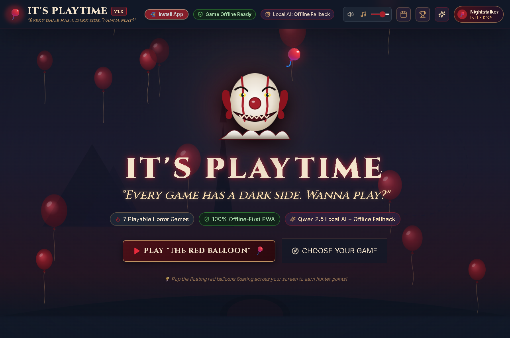
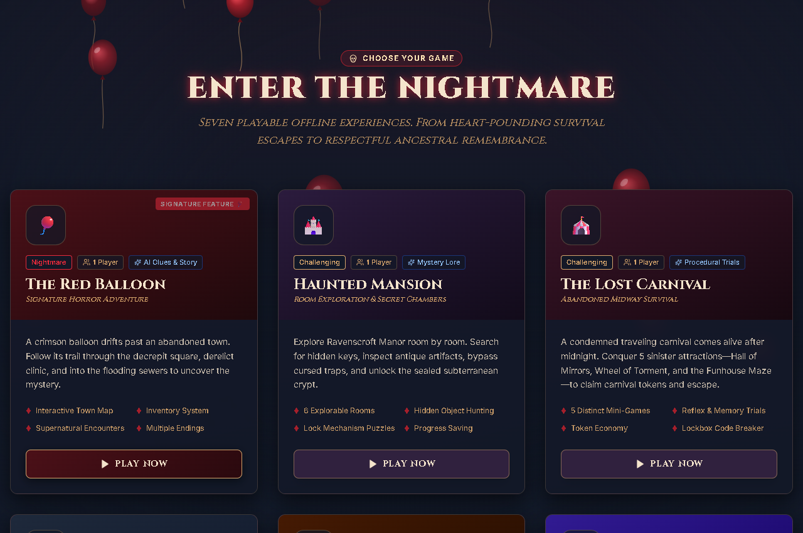
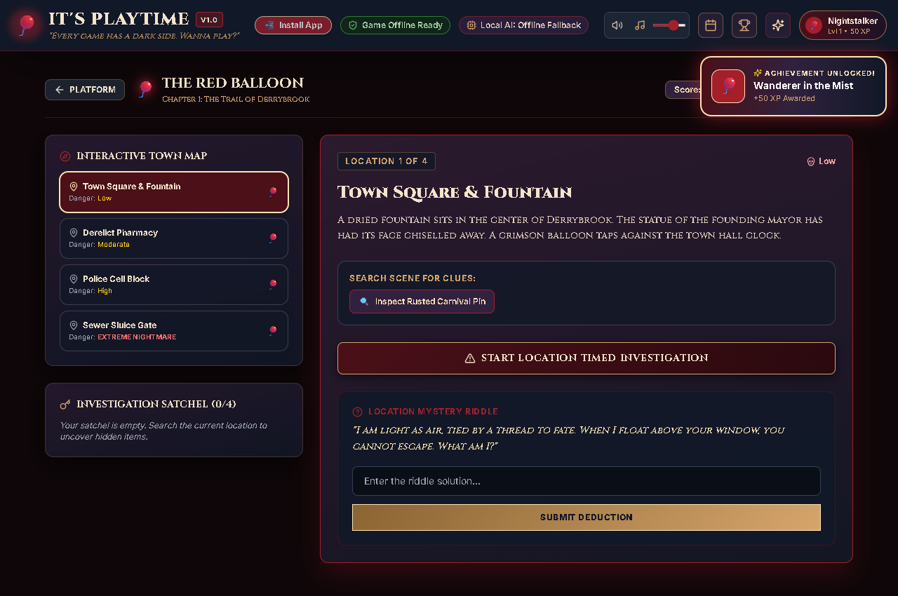
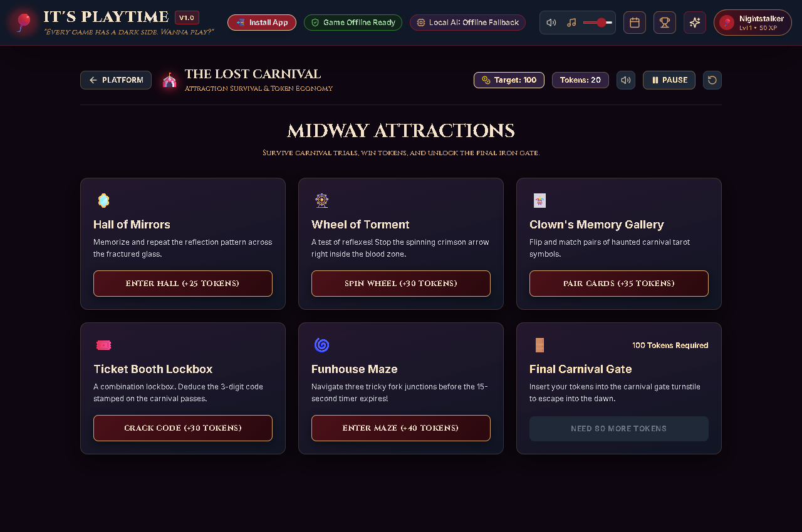
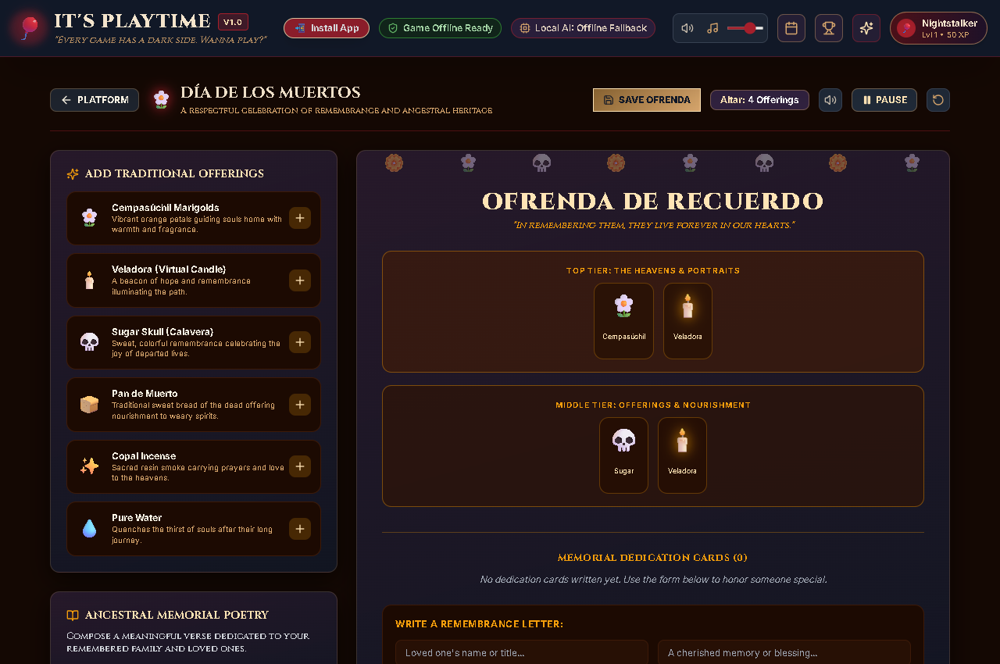
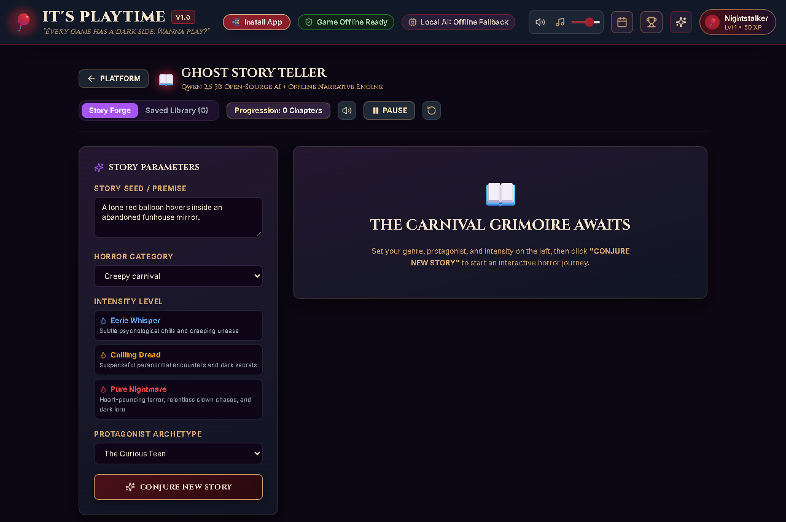
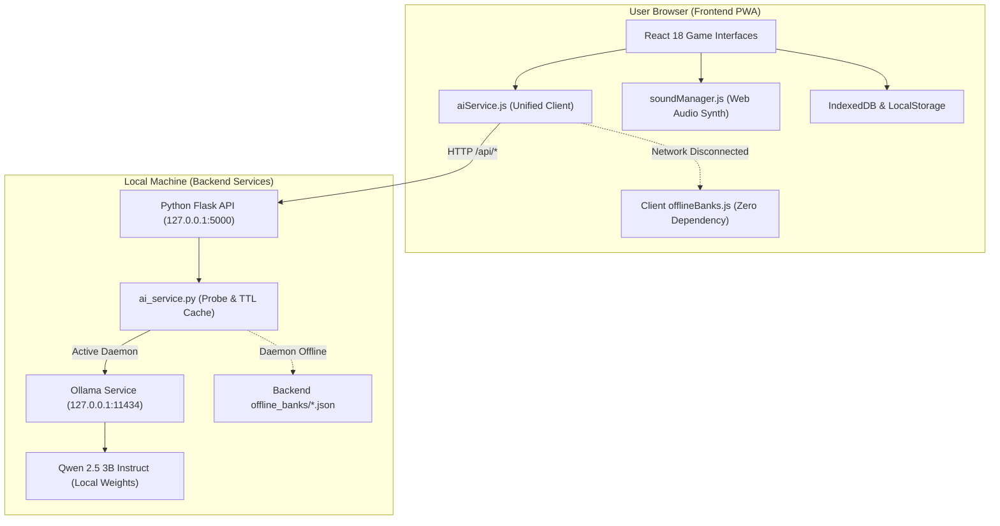

# 🎈 IT's Playtime
> ### *"Every game has a dark side. Wanna play?"*

[](https://opensource.org/licenses/MIT)
[](https://developer.mozilla.org/en-US/docs/Web/Progressive_web_apps)
[](https://ollama.com)
[](https://react.dev)
[](https://flask.palletsprojects.com/)
[](https://nitu-bathyal.github.io/its-playtime/)
[](demo/ITs_Playtime_Project_Demo.mp4)

> 🎮 **Play Live Now:** [https://nitu-bathyal.github.io/its-playtime/](https://nitu-bathyal.github.io/its-playtime/)  
> 🎬 **Watch Full HD Project Demo Video:** [demo/ITs_Playtime_Project_Demo.mp4](demo/ITs_Playtime_Project_Demo.mp4) (Complete Walkthrough of all 7 Games, AI & PWA)

---

## 📖 1. Project Overview

**IT's Playtime** is an advanced, offline-first AI horror gaming platform inspired by classic clown horror, abandoned midways, floating red balloons, decrepit storm sewers, and supernatural mysteries.

Unlike static landing pages or simulated prototypes, **IT's Playtime is a real, fully functional gaming ecosystem**. Players can explore interactive town maps, pick up items, solve cryptographic logic locks, survive timed reflex carnival attractions, play 1–4 player local pass-and-play party duels, build virtual ancestral ofrendas, and participate in multi-paragraph branching interactive horror novels powered by an open-weight local AI model (**Qwen 2.5 3B Instruct** running locally via **Ollama**).

The platform requires **zero internet connection** after initial setup, **zero paid cloud API keys**, and features a built-in **procedural Web Audio synthesizer** that produces chilling atmospheric soundscapes without downloading large external audio files.

---

##  2. Problem Statement

Most modern web games and AI-assisted experiences suffer from three major vulnerabilities:

1. **Vendor Lock-In & Paid API Fragility**: Most "AI games" depend on expensive proprietary cloud APIs (OpenAI, Anthropic, Google Cloud). When API tokens expire, rates increase, or servers experience downtime, the game breaks entirely for the player.
2. **Online-Only Enforced Connectivity**: Modern browser games fail completely if the user loses Wi-Fi connection, travels on a flight, commutes through tunnels, or suffers a network blackout.
3. **External Asset Dependency**: Heavy reliance on remote Content Delivery Networks (CDNs), streaming audio servers, and cloud-hosted fonts means missing network packets can result in unstyled layouts, silent gameplay, or broken images.

### How IT's Playtime Solves This:
* **Genuine Open-Source Local AI**: Uses **Qwen 2.5 3B Instruct** through **Ollama** on `localhost:11434`. All generative inference executes directly on the user's hardware.
* **Dual-Tier Offline Architecture**: If the local AI model is not running, the application seamlessly activates an internal curated horror engine and procedural question banks with zero interruption.
* **Progressive Web App (PWA) with IndexedDB**: Full offline asset caching via a custom Service Worker (`sw.js`) and persistent local game state storage via IndexedDB (`its_playtime_db`).
* **100% Offline Procedural Soundscape**: A custom Web Audio API synthesizer generates creepy music box melodies, sub-bass heartbeats, and tactile sound effects using math and oscillators—zero audio assets to download.

---

## 🕹️ 3. Features & The Seven Playable Games

### Core Platform Features
* **Atmospheric Visual Universe**: Deep burgundy (`#4B1018`), blood red (`#A51F2B`), midnight navy (`#111827`), and antique gold (`#D6A56C`) palette with original character artwork, fog layers, and candle flicker effects.
* **Interactive Canvas Balloon Physics**: Floating crimson balloons drift and wobble across the screen; players can click or tap to pop them for tactile audio feedback and bonus XP.
* **In-Game Pause, Resume & Restart**: Every game features a unified in-game header to pause countdown timers, resume, or restart the session.
* **Player Progression System**: Nickname customization, 7 spooky avatars, XP level formula, 16 unlockable horror achievements with live pop-up toast alerts, and a local hall-of-fame leaderboard.
* **Dual Header Status Badges**: Independent badges for "Game Offline Ready" (Service Worker status) and "Local AI Status" (Ollama daemon status).

---

### The Seven Playable Experiences

| Game | Mode & Type | Core Gameplay & Mechanics |
| :--- | :--- | :--- |
| **1. The Red Balloon** | *Signature Feature (Survival Mystery)* | Explore the abandoned town of Derrybrook across 4 areas (Town Square, Pharmacy, Police Cell Block, Sewer Sluice Gate). Search scenes for 4 investigation artifacts (Rusted Pin, Mortar Key, Vance's Badge, Valve Wheel), survive 60-second tension countdown challenges with real-time heartbeat audio, decode riddle locks, and escape through the sewer gates with multiple endings. |
| **2. Haunted Mansion** | *Room Exploration & Secret Passages* | Navigate 6 wings of Ravenscroft Manor (Grand Foyer, Library, Conservatory, Cellar, Subterranean Crypt). Inspect antiques, locate brass keys, solve grandfather clock dial times, decode Caesar shifted book spines, and break the curse holding the spirits. Saved progress persists in IndexedDB. |
| **3. The Lost Carnival** | *Midway Survival & Token Economy* | Survive 5 distinct midway mini-games: **Hall of Mirrors** (pattern recognition), **Wheel of Torment** (reflex timing), **Clown's Memory Gallery** (tarot pairing), **Ticket Booth Lockbox** (code breaker), and **Funhouse Maze** (15s timed path navigation). Earn 100+ carnival tokens to unlock the final turnstile gate and escape. |
| **4. Ghost Party** | *1–4 Local Multiplayer / Solo* | Pass-and-play party game on a single shared screen without internet. Face randomized horror trivia quizzes and spirit bluffing / deception challenges. Features live player scoreboards, round management, and a coronation ceremony for the winning player. |
| **5. Day of the Dead** | *Cultural Remembrance Experience* | A respectful celebration of ancestral memory. Build a 3-tier virtual ofrenda by placing *cempasúchil* marigolds, sugar skulls (*calaveras*), *pan de muerto*, copal incense, and flickering candles. Write personal dedication cards, generate heartfelt memorial verses, and save ofrendas locally to IndexedDB. |
| **6. Ghost Story Teller** | *Interactive Generative AI Novel* | The premier AI-powered narrative experience. Configure premise, 7 genres, 3 horror intensities (*Eerie Whisper*, *Chilling Dread*, *Pure Nightmare*), and 5 protagonist archetypes. Generates multi-paragraph chapters with 3 interactive branching choices per turn. Supports continuing stories, saving to journal, and reading history. Powered by Qwen 2.5 3B with curated offline fallback. |
| **7. The Lost Key** | *Cryptographic Trials & Vaults* | 5 progressive vault stages: **Stage 1 (Novice)** doubling tumbler, **Stage 2 (Investigator)** Caesar shift cipher, **Stage 3 (Cryptographer)** cathedral prime sequence, **Stage 4 (Master)** alchemical rune length formula, and **Stage 5 (Grandmaster)** Three Haunted Statues truth/lie logic deduction. Features a tiered hint system without immediate spoilers. |

---

## 🖼️ 4. Screenshots

### Hero & Atmospheric Ambiance


### Choose Your Game (7 Illustrated Cards)


### The Red Balloon (Signature Survival Mystery)


### The Lost Carnival (Midway Survival & Mini-Games)


### Día de los Muertos (3-Tier Digital Ofrenda Builder)


### Ghost Story Teller (Interactive Local AI Novel Forge)


---

## 💻 5. Technology Stack

### Frontend
* **React 18**: Component-driven reactive UI architecture.
* **Vite 5**: Optimized ES-module dev server and production bundler.
* **Tailwind CSS 3**: Custom horror design token system with responsive breakpoints.
* **Lucide React**: Clean, locally-bundled vector iconography.
* **Web Audio API**: Procedural sound engine (no external audio files required).

### Backend
* **Python 3.10+ / 3.13**: Lightweight, reliable local web service.
* **Flask 3 & Flask-CORS**: High-performance REST API routing.
* **Requests**: Local HTTP client for daemon communication.

### Storage & Offline Infrastructure
* **IndexedDB (`db.js`)**: Object stores for `game_saves`, `stories`, `ofrendas`, `achievements`, and `leaderboard`.
* **LocalStorage (`storage.js`)**: Instant synchronous preferences (sound volume, player nickname, avatar).
* **Service Worker (`public/sw.js`)**: Stale-while-revalidate asset caching and offline navigation fallbacks.
* **Web App Manifest (`public/manifest.json`)**: Standalone PWA desktop and mobile installation.

### Artificial Intelligence
* **Ollama**: Local AI runner.
* **Qwen 2.5 3B Instruct**: Open-weight large language model for horror stories, dialogue, riddles, and mystery clues.
* **Curated Fallback Engine (`offlineBanks.js`)**: Client and backend pre-built narrative graphs guaranteeing 100% offline availability.

---

## 🧠 6. Open-Source AI Architecture

### Why Open-Source AI Matters
Most commercial "AI games" connect to remote cloud APIs (e.g., OpenAI GPT-4, Anthropic Claude). This introduces major drawbacks:
1. **Financial Barrier**: Requires monthly subscriptions or pay-per-token API credit.
2. **Privacy Risks**: Player inputs, names, and stories are transmitted to third-party cloud servers.
3. **No Offline Support**: Any loss of internet connectivity immediately halts the gameplay.

By contrast, **IT's Playtime uses open-weight local AI**:
* **100% Free**: No subscription, no credit card, no API keys.
* **100% Private**: Prompt processing and generation stay entirely on your machine.
* **100% Offline**: Once the model weights are pulled to your device, inference runs with your network cable unplugged.



---

## 🤖 7. Qwen 2.5 3B + Ollama Integration Guide

### Step 1: Install Ollama
Download and install the free, open-source Ollama runtime for your operating system:
* **Download link**: [https://ollama.com](https://ollama.com)

### Step 2: Download the Qwen 2.5 3B Model
Open your terminal (PowerShell, Command Prompt, or Bash) and execute:
```bash
ollama run qwen2.5:3b
```
*This downloads the compact, highly capable 3-billion-parameter open-weight model (~1.9 GB) optimized for instruction following and creative horror writing.*

### Step 3: Verify Local Daemon
Verify that Ollama is listening locally by visiting `http://localhost:11434` or running:
```bash
ollama list
```
You will see `qwen2.5:3b` listed under your local models.

---

## ⚙️ 8. Installation & Setup Instructions

### Prerequisites
* **Node.js** (v18.0.0 or higher)
* **Python** (v3.10.0 or higher)
* **Git** (optional)

### Clone / Navigate to Project Directory
```powershell
Set-Location "C:\Users\DELL\.gemini\antigravity\scratch\its-playtime"
```

---

## 🚀 9. How to Run Frontend and Backend

### Option A: One-Click Launch (Windows PowerShell)
From the project root:
```powershell
.\run.ps1
```
*This automatically starts the Python backend on `http://127.0.0.1:5000` and launches the Vite frontend dev server on `http://localhost:5173`.*

---

### Option B: Manual Startup (Dual Terminal)

#### Terminal 1 — Python Flask AI Backend
```powershell
cd backend
python -m pip install -r requirements.txt
python app.py
```
*Console output will display:*
```text
[*] IT's Playtime Backend running on http://127.0.0.1:5000
 * Serving Flask app 'app'
 * Running on http://127.0.0.1:5000
```

#### Terminal 2 — Frontend Dev Server
```powershell
cd frontend
npm install
npm run dev
```
*Console output will display:*
```text
  VITE v5.4.21  ready in 250 ms

  ➜  Local:   http://localhost:5173/
  ➜  Network: http://localhost:5173/
```

Open **`http://localhost:5173/`** in your web browser.

---

## 📴 10. How to Play 100% Offline

Once you have opened the application in your browser at least once:

1. **Install as a PWA (Optional)**:
   * Click the **"Install App"** pill in the top navigation bar, or click your browser's install icon in the address bar.
2. **Disconnect from the Internet**:
   * Turn off your Wi-Fi or unplug your Ethernet cable.
3. **Play Without Network**:
   * All 7 games, audio synthesizers, saves, and puzzles remain fully functional.
   * If Ollama is running locally, AI story generation continues to run on your GPU/CPU without internet.
   * If Ollama is stopped, the application automatically uses its built-in offline horror question banks, prewritten narrative branches, and procedural puzzle generators.

---

## 🧪 11. Verification & Testing

The platform includes automated test suites across both the backend and frontend:

### Backend Integration Test Suite (7/7 Passed)
```powershell
cd backend
python test_platform.py
```
*Tests verified:*
* Health check & offline readiness validation.
* Real Ollama daemon probe and TTL caching.
* Multi-paragraph horror story generation.
* Interactive branching story continuation.
* Riddle generation and answer verification.
* Cryptographic puzzle logic and solution validation.
* Mystery clue generation.

### Frontend QA Invariant Suite
```powershell
cd frontend
node audit_test.mjs
```
*Tests verified:*
* Offline riddle bank structure and answer normalization.
* Cryptographic sequence and cipher puzzle rules.
* Curated story graph integrity.
* Mathematical XP and player level formulas.

### Production Build Test
```powershell
cd frontend
npm run build
```
*Compiles the production PWA bundle cleanly into `dist/`.*

---

## 🔮 12. Future Improvements

* **WebGPU / Transformers.js Integration**: Run sub-1B parameter models directly within browser WebGPU threads for device-agnostic in-browser inference without requiring Ollama.
* **Additional Story Genres**: Expansion into cosmic horror (Lovecraftian), deep-sea abyssal mysteries, and urban legends.
* **Local Multiplayer Bluetooth / WebRTC**: Peer-to-peer offline multiplayer between phones on the same local subnet.
* **Custom Custom Ofrenda Exporter**: High-resolution PNG and PDF export for printing personal memorial ofrendas.

---

## 📜 13. License & Credits

* **License**: Released under the open-source [MIT License](LICENSE).
* **Artwork & Visual Design**: All clown illustrations, carnival graphics, audio synthesizer waveforms, and storylines are original creative works crafted specifically for **IT's Playtime**. No copyrighted movie footage or proprietary assets are used.
* **Author**: Built with passion for offline-first architecture, local AI, and classic atmospheric horror.

---

🎈 **"You float, you play, you survive. Welcome to IT's Playtime."**
